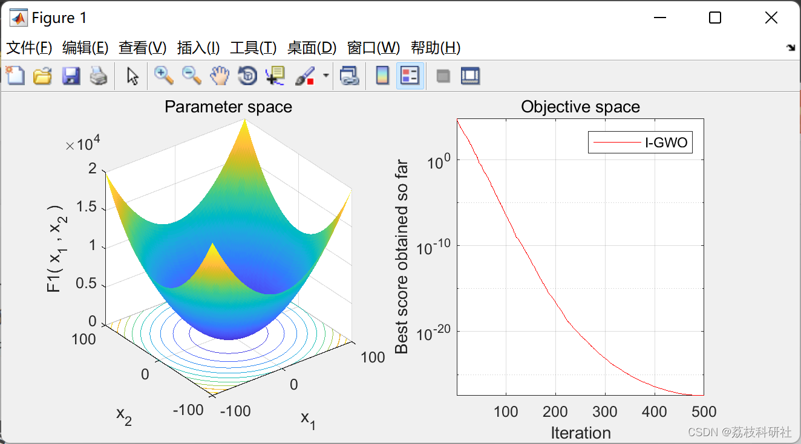
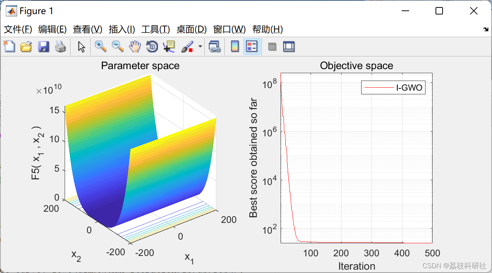
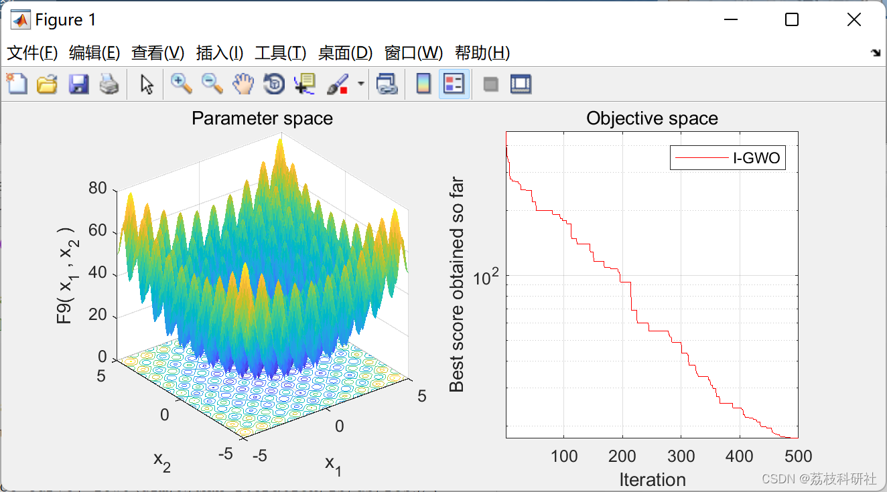
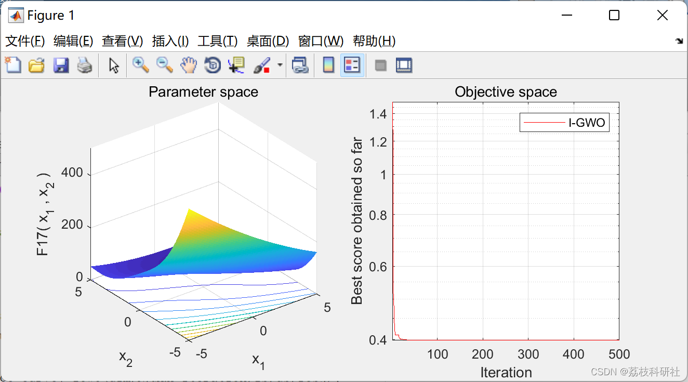
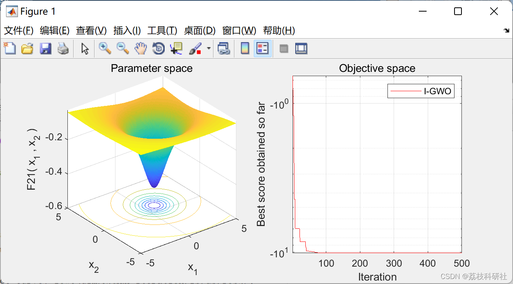
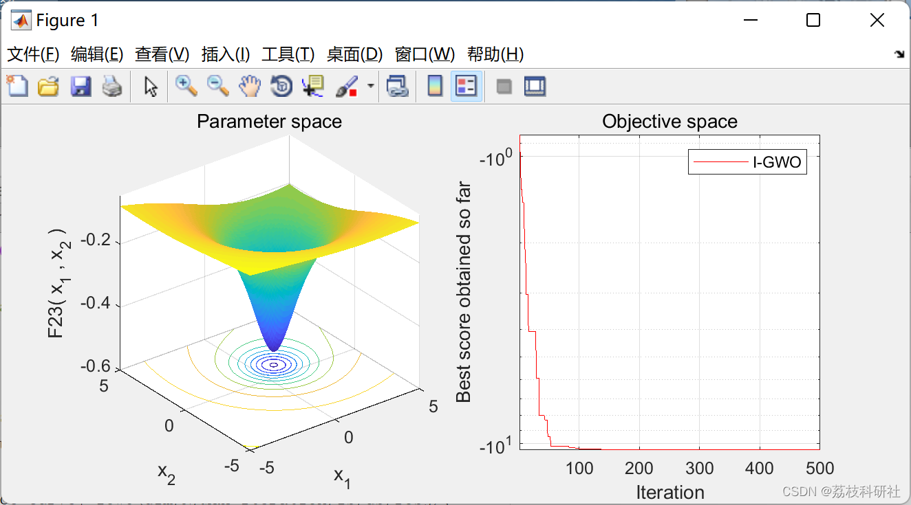

# [Improved Gray Wolf Optimization Algorithm] Improved Gray Wolf Optimization Algorithm Based on Coordinated Exploration and Development Capabilities to Solve Single-Objective Optimization Problems (Matlab Code Implementation)

📚2 Running Results
Edit
Edit
Edit
Edit
Edit
Part of the code: Improved Grey Wolf Optimizer (I-GWO)
function [Alpha_score,Alpha_pos,Convergence_curve]=IGWO(dim,N,Max_iter,lb,ub,fobj)  
lu = [lb .* ones(1, dim); ub .* ones(1, dim)];  
% Initialize alpha, beta, and delta positions  
Alpha_pos=zeros(1,dim);  
Alpha_score=inf; %change this to -inf for maximization problems  
Beta_pos=zeros(1,dim);  
Beta_score=inf; %change this to -inf for maximization problems  
Delta_pos=zeros(1,dim);  
Delta_score=inf; %change this to -inf for maximization problems  
% Initialize the positions of wolves  
Positions=initialization(N,dim,ub,lb);  
Positions = boundConstraint (Positions, Positions, lu);
% Calculate objective function for each wolf  
for i=1:size(Positions,1)  
Fit(i) = fobj(Positions(i,:));  
end  
% Personal best fitness and position obtained by each wolf  
pBestScore = Fit;  
pBest = Positions;  
neighbor = zeros(N,N);  
Convergence_curve=zeros(1,Max_iter);  
iter = 0;% Loop counter  
%% Main loop  
while iter < Max_iter  
for i=1:size(Positions,1)  
fitness = Fit(i);  
% Update Alpha, Beta, and Delta  
if fitness<Alpha_score  
Alpha_score=fitness; % Update alpha  
Alpha_pos=Positions(i,:);  
end  
if fitness>Alpha_score && fitness<Beta_score  
Beta_score=fitness; % Update beta  
Beta_pos=Positions(i,:);  
end  
if fitness>Alpha_score && fitness>Beta_score && fitness<Delta_score  
Delta_score=fitness; % Update delta  
Delta_pos=Positions(i,:);  
end  
end  
%% Calculate the candiadate position Xi-GWO  
a=2-iter*((2)/Max_iter); % a decreases linearly from 2 to 0  
% Update the Position of search agents including omegas  
for i=1:size(Positions,1)  
for j=1:size(Positions,2)  
r1=rand(); % r1 is a random number in [0,1]  
r2=rand(); % r2 is a random number in [0,1]  
A1=2*a*r1-a;                  % Equation (3.3)  
C1=2*r2;                    % Equation (3.4)  
D_alpha=abs(C1*Alpha_pos(j)-Positions(i,j));  % Equation (3.5)-part 1  
X1=Alpha_pos(j)-A1*D_alpha;          % Equation (3.6)-part 1  
r1=rand();  
r2=rand();  
A2=2*a*r1-a;                  % Equation (3.3)  
C2=2*r2;                    % Equation (3.4)  
D_beta=abs(C2*Beta_pos(j)-Positions(i,j));   % Equation (3.5)-part 2  
X2=Beta_pos(j)-A2*D_beta;           % Equation (3.6)-part 2  
r1=rand();  
r2=rand();  
A3=2*a*r1-a;                  % Equation (3.3)  
C3=2*r2;                    % Equation (3.4)  
D_delta=abs(C3*Delta_pos(j)-Positions(i,j));  % Equation (3.5)-part 3  
X3=Delta_pos(j)-A3*D_delta;          % Equation (3.5)-part 3  
X_GWO(i,j)=(X1+X2+X3)/3;            % Equation (3.7)  
end  
X_GWO(i,:) = boundConstraint(X_GWO(i,:), Positions(i,:), lu);  
Fit_GWO(i) = fobj(X_GWO(i,:));  
end  
%% Calculate the candiadate position Xi-DLH  
radius = pdist2(Positions, X_GWO, 'euclidean');    % Equation (10)  
dist_Position = squareform(pdist(Positions));  
r1 = randperm(N,N);  
for t=1:N  
neighbor(t,:) = (dist_Position(t,:)<=radius(t,t));  
[~,Idx] = find(neighbor(t,:)==1);         % Equation (11)  
random_Idx_neighbor = randi(size(Idx,2),1,dim);  
for d=1:dim  
X_DLH(t,d) = Positions(t,d) + rand .*(Positions(Idx(random_Idx_neighbor(d)),d)...  
- Positions(r1(t),d));           % Equation (12)  
end  
X_DLH(t,:) = boundConstraint(X_DLH(t,:), Positions(t,:), lu);  
Fit_DLH(t) = fobj(X_DLH(t,:));  
end  
%% Selection  
tmp = Fit_GWO < Fit_DLH;                % Equation (13)  
tmp_rep = repmat(tmp',1,dim);  
tmpFit = tmp .* Fit_GWO + (1-tmp) .* Fit_DLH;  
tmpPositions = tmp_rep .* X_GWO + (1-tmp_rep) .* X_DLH;  
%% Updating  
tmp = pBestScore <= tmpFit;              % Equation (13)  
tmp_rep = repmat(tmp',1,dim);  
pBestScore = tmp .* pBestScore + (1-tmp) .* tmpFit;  
pBest = tmp_rep .* pBest + (1-tmp_rep) .* tmpPositions;  
Fit = pBestScore;  
Positions = pBest;  
🎉3 References
[2]Seyedali Mirjalili (2022). Improved Grey Wolf Optimizer (I-GWO)  
🌈4 Matlab code implementation

## Images

<!-- PAYMENT_BLOCK -->

## Get this dataset

- Payment link (Stripe): [Buy now](https://buy.stripe.com/3cs8yP7sY87d0vu9AB)
- Payment QR code: 

<!-- /PAYMENT_BLOCK -->
